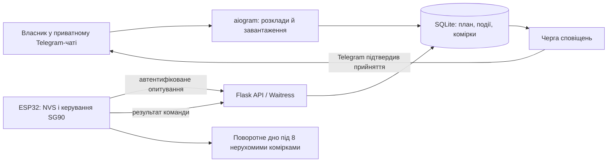

# Архітектура для пояснювальної записки

## Призначення й межі

MediTrack зберігає вісім попередньо відміряних доз. Він не відраховує таблетки
з загального бункера та не визначає лікарську дозу. Користувач задає щоденні
часи в Telegram, а під час завантаження отримує конкретні вісім майбутніх
датованих подій. Їхні дози потрібно покласти саме в зазначені комірки.



## Вибір реалізації

Пакет `meditrack` став єдиною реалізацією. Вихідний вкладений варіант уже
розділяв API, бота й SQL, тому його структуру збережено. Обидві старі
реалізації потребували зміни моделі даних: статус щоденного розкладу не може
одночасно бути статусом конкретної видачі. Кореневі файли тепер лише передають
керування пакету, а старі файли лежать у `legacy` як текстові архіви.

SQLite обрано для одного локального сервера курсового прототипу. `BEGIN
IMMEDIATE` серіалізує зміну стану: два паралельні запити не резервують дві
комірки. `WAL`, `busy_timeout`, зовнішні ключі та гарантоване закриття з'єднань
налаштовано централізовано. Базу слід тримати на локальному диску, не відкривати
одночасно з різних комп'ютерів і не синхронізувати активний файл через хмару.
Зміну станів явними SQL-транзакціями підтримує стандартний
[модуль sqlite3](https://docs.python.org/3/library/sqlite3.html).

## Сутності

| Таблиця | Призначення |
|---|---|
| `devices` | Telegram-власник, хеш секрету, режим, позиція, цикл |
| `schedules` | Активний щоденний час і назва дози; не вимикається після видачі |
| `refill_plans` | Зафіксований план восьми доз до ручного завантаження |
| `compartments` | Стан кожної з восьми фізичних комірок і пов'язана подія |
| `events` | UUID, пристрій, цикл, дата/час, комірка, тип і результат команди |
| `notifications` | Окрема черга Telegram, спроби, помилки й статус прийняття |
| `legacy_records` | Вихідні записи, збережені явною міграцією для аудиту |

Схема — `meditrack/schema.sql`. Події видачі створюються при реєстрації
завантаження, а не щохвилини. Завершена видача не вимикає щоденний розклад.
Новий цикл знову формує наступні вісім дат. Дата/час зберігаються як UTC epoch
та як локальне календарне значення; відображення використовує Europe/Kyiv.

## Часова політика

- До запланованого моменту видача не починається.
- Допустиме запізнення — включно **300 секунд** після запланованого моменту.
- Прострочена неотримана команда стає `missed`; пристрій блокується. Сервер
  не перескакує через завантажену дозу до наступної комірки.
- Уже отримана команда повторно повертається з тим самим UUID, щоб відновити
  підтвердження після розриву мережі. Прошивка перевіряє термін перед початком
  нового руху; збережений результат завершеного руху можна підтвердити пізніше.
- Перехід через північ обробляється абсолютним часом, без порівняння рядків
  `ГГ:ХХ` або запиту глобального поточного часу.
- За правилами бази часових зон, якщо місцевий час пропущений навесні, цієї
  дати події для нього немає. Якщо час повторюється восени — лише перша
  поява (`fold=0`). Календарні правила беруться з `tzdata`, не зашиті в коді.
- При тривалому простої автоматичного «наздоганяння» пропущених доз немає.

## API пристрою

Кожен `/api/*` запит потребує `X-Device-ID` та `Authorization: Bearer SECRET`.
Немає анонімного глобального списку розкладів. ID власника не приймається з
тіла запиту ESP32. Тіло підтвердження — об'єкт JSON з рівно двома полями.

| Метод і шлях | Результат |
|---|---|
| `GET /` | Загальна перевірка сервісу, без особистих даних |
| `GET /api/check` | `WAIT`, `DISPENSE` або `HOME` для цього пристрою |
| `POST /api/confirm` | Відомий результат саме цієї події |
| `GET /api/status` | Режим, цикл, позиція й комірки цього пристрою |
| `GET /api/schedules` | Щоденні розклади цього пристрою |
| `GET /api/events` | Історія цього пристрою |

```json
{
  "status": "DISPENSE",
  "event_id": "00000000-0000-4000-8000-000000000001",
  "cycle_id": "00000000-0000-4000-8000-000000000002",
  "compartment": 1,
  "previous_compartment": 0,
  "angle": 20,
  "scheduled_at": 1794904200,
  "expires_at": 1794904500,
  "scheduled_local": "2026-11-17T10:30"
}
```

Приклад має ілюстративні ідентифікатори. Підтвердження:

```json
{"event_id":"00000000-0000-4000-8000-000000000001","outcome":"command_completed"}
```

Результати: `command_completed`, `uncertain`, `not_started`; для Home —
`homed`. Повторний запит повертає записаний результат навіть якщо надісланий
інший допустимий outcome: попередня історія не переписується. `uncertain`
або `not_started` блокують послідовність. Новий Home не дозволений, поки є
непідтверджена команда видачі.

`notification_status=sent` означає, що Telegram API прийняв повідомлення,
а не що користувач прочитав його. Помилка Telegram не скасовує результат
руху. Черга повторює доставку із затримкою; в разі втрати відповіді Telegram
можливий дубль повідомлення, оскільки sendMessage не має ключа ідемпотентності.
Це не створює повторної команди SG90.

## Межі гарантій

NVS та унікальні події захищають від звичайних повторів і перезапусків. Без
датчика положення, датчика падіння та механічного зворотного зв'язку неможливо
довести фізичну видачу рівно один раз. Знеструмлення під час руху, зсув диска
або заклинювання потребують огляду. Відновлення БД із давньої резервної копії,
заміна ESP32 або очищення NVS потребують повного сервісного циклу, а не
продовження видачі за старим планом.
