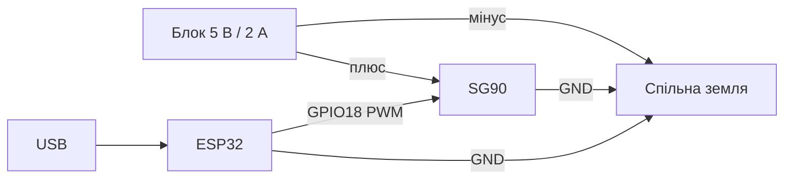

# Підключення

Окрема схема: [wiring.svg](wiring.svg).

| Вивід | З'єднання |
|---|---|
| ESP32 GPIO18 | Сигнальний провід SG90 (зазвичай помаранчевий) |
| SG90 живлення | Окремий стабілізований 5 В блок, попередньо не менше 2 А |
| SG90 GND | Мінус блока та GND ESP32 |
| ESP32 USB | Живлення й програмування від USB |

Не живіть SG90 від 3V3 ESP32. Біля сервопривода встановіть 470–1000 мкФ та
100 нФ між живленням і землею. Це попередня рекомендація; виміряйте провали
напруги осцилографом і піковий струм конкретного SG90. Не з'єднуйте зовнішні
5 В із USB/VIN плати, поки не перевірено схему саме вашої ESP32-плати.
Колір проводів і допустимий рівень сигналу слід підтвердити для наявного SG90.
